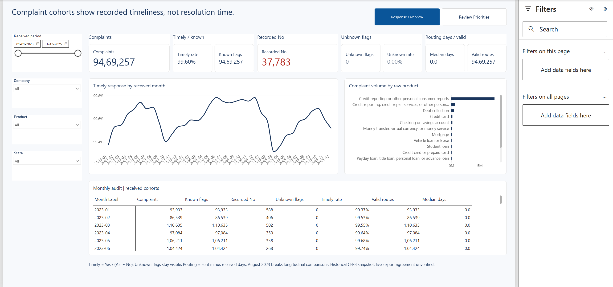
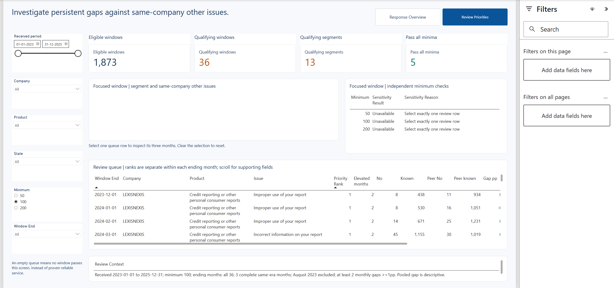

In the frozen 2023–2025 population of 9,469,257 CFPB complaints, the approved review rule identifies [36 qualifying segment-windows across 13 segments](docs/findings.md), with five windows qualifying at all three tested volume minima.

**Recommended option:** audit the historical October–December 2025 MOHELA student-loan response records for “Dealing with your lender or servicer,” using the [monthly segment and other-issue denominators](docs/findings.md#1-the-overall-recorded-timely-rate-masks-a-concentrated-investigation-question) to assess the recorded gap and its sensitivity to comparator volume.

# Complaint Response Reliability

An analysis of consumer complaint response timeliness across products and issues. The project uses SQL and Power BI to identify historical segments for investigation and show how the review queue changes with volume thresholds.

**Status:** Complete, 2026-10-28  
**Data:** CFPB consumer complaints, 2023–2025  
**Tools:** SQL, DuckDB, Power BI Desktop

## Key findings

In the frozen population of **9,469,257 complaints**, the base review rule identifies **36 qualifying segment-windows across 13 segments**. Five windows qualify at all three tested volume minima.

One proposed investigation is MOHELA's October–December 2025 student-loan complaints for the issue “Dealing with your lender or servicer.” The window passes the 50 and 100 minimum thresholds but fails the 200 threshold because of comparator volume. This is an issue-level review question, not an overall company ranking. See the [findings](docs/findings.md) for denominators and caveats.

## Report

The two-page Power BI report provides an overview of response timeliness and a review queue with volume sensitivity. [Build acceptance](outputs/final_build_acceptance_20261028.json) records clean-folder refresh, 2,194 live field comparisons, reviewed pages and owner-reported interaction checks at Fit to page.

[Open the Power BI project](reports/powerbi/F1.pbip) | [Model and setup](docs/model.md)

## Approach

- Retained all products and original fields for complaints received from January 2023 through December 2025; preserved unknown response flags separately from known outcomes.
- Compared each company/product/issue segment with the same company's other issues in the corresponding product and geography.
- Screened three-month windows using per-month segment and comparator volume minima of 50, 100 and 200, with a persistence rule for elevated untimely response share.
- Reconciled SQL results against independent calculations and checked the live Power BI model across selected filter and threshold contexts.

The [metric dictionary](docs/metric_dictionary.md), [analysis method](docs/analysis_method.md) and [technical evidence](docs/technical_evidence.md) describe the rules and validation in detail.

## Presentation

The report uses F1's ink-navy primary `#1B365D`, teal comparator `#0F766E` and planned soft tint `#EDF1F7`, with the portfolio's neutral canvas, white containers and Segoe UI. The overview emphasizes received-month timeliness and an audit table; the priority page pairs a sparse review queue with focused monthly evidence and independent threshold checks. Labels and numerator/denominator fields support the color encoding. Long raw product labels can truncate in the chart, and supporting queue fields require horizontal scrolling.

## Reproduce and validate

Follow the [environment guide](docs/environment.md) for source preparation and pipeline entry points. To use the Power BI project after moving it, set **Source Folder** to the compact Parquet input directory described in the [model documentation](docs/model.md). The large raw and prepared data files are local inputs rather than files included in the repository.

Source preparation, analytical findings, live model reconciliation, clean-folder refresh and report acceptance pass within the recorded scopes. See the [validation record](docs/validation.md), [post-build measurements](outputs/final_claim_measurements_20261028.json) and [independent focal audit](outputs/final_claim_audit_20261028.json). The isolated test copy is verification evidence; use the report linked above as the portfolio entry point.

## Limitations

- Timeliness is based on recorded response flags; unknown flags remain separate. Routing lag is not resolution time.
- The frozen file was supplied as an official download, but its original download date was not recorded and comparison with a current official export remains unverified. See the [data manifest](docs/data_manifest.md).
- The queue depends on the selected scope, comparator and volume rule. It identifies questions for review, not confirmed misconduct or causal explanations.
- August 2023 remains in overview totals but breaks longitudinal review-window continuity because of the timing-era boundary.
